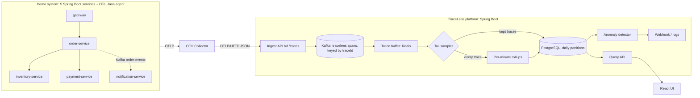

# TraceLens: Distributed Request Tracing & Failure Analysis

TraceLens follows a single request as it moves through several backend services. It rebuilds the full path, finds the service that actually caused a failure or slowdown, and raises an alert when an operation's behaviour changes.

It collects data with OpenTelemetry. On top of that it adds its own backend: an ingest API, Kafka, tail sampling backed by Redis, partitioned PostgreSQL storage, trace analysis (critical path, clock-skew correction, root cause), a service dependency graph, anomaly alerts, and a React UI.



## How each engineering challenge is handled

| Challenge | Implementation |
|---|---|
| **Trace context propagation** | W3C `traceparent` + `baggage` across HTTP (OTel agent instruments the JDK HttpClient) **and across Kafka**: order-service publishes and notification-service consumes, and the consumer span joins the original trace through record headers. Manual spans use `@WithSpan`. |
| **Distributed correlation IDs** | `CorrelationIdFilter` takes `X-Correlation-Id` from the edge (or generates one), puts it in **W3C baggage** so it travels on every HTTP and Kafka hop, adds it to every span as `correlation.id`, and puts it in the logging **MDC** next to `trace_id`/`span_id`. Every log line can therefore be joined to a trace. |
| **Latency analysis** | Per-minute **log-scale histograms** (100 buckets, ≤20% error) can be merged by addition, so p50/p95/p99 work over any time window in SQL. Each trace also gets **self time**, **critical-path** analysis (which spans actually set the end-to-end latency) and a **bottleneck** callout. |
| **Failure detection** | Every trace gets a **root-cause hint**: the deepest failing span, with its exception type and message. An **anomaly detector** compares each operation's last 5 minutes with the hour before and flags **error-rate spikes** and **p95 regressions**. Alerts are de-duplicated by key, include the top error and an example trace, resolve automatically, and can be sent to a Slack-compatible webhook. |
| **Service dependency graph** | Built from parent→child spans that cross a service boundary. Edges carry call count, error rate and average latency. Drawn as an interactive map. |
| **Sampling & storage** | **Head sampling** in the SDK (configurable) plus **tail sampling** in TraceLens. Spans wait in Redis until a trace has been quiet for 10 s. Then the sampler keeps 100% of errors, 100% of traces slower than their operation's learned p99, and a deterministic 10% of the rest (hash of the trace ID). Late spans follow the original decision. Metrics are computed **before** sampling, so they stay exact. Storage uses **daily range partitions**: retention is `DROP PARTITION`, with no bloat from DELETE. |
| **Scale & reliability** | Kafka absorbs ingest bursts and is keyed by trace ID. Ready traces are claimed with a single atomic Lua script, so several platform instances can run in parallel. JDBC batch inserts are idempotent (`ON CONFLICT DO NOTHING`) because Kafka delivers at least once. Rollup upserts are additive and sorted (no deadlocks). A failed rollup flush is retried. |

Other details:
- **Clock-skew correction**: a server span that appears to start before its client call (because the hosts' clocks differ) is shifted back inside the client span, together with its children. Async consumers are left alone.
- **Orphan handling**: spans whose parent never arrived are marked as orphans.
- **Fault injection**: the UI can add latency or errors to any demo service at runtime, so you can create an incident and watch it get detected.

## Tech stack

Java 21 · Spring Boot 3.4 · OpenTelemetry (Java agent 2.10, Collector 0.114) · Apache Kafka 3.8 (KRaft) · Redis 7 · PostgreSQL 16 (native partitioning, Flyway) · React 18 + TypeScript + Vite + Tailwind · React Flow · Recharts · JUnit 5 · Testcontainers · k6 · Docker Compose · GitHub Actions · Micrometer/Prometheus

## Repository layout

```
TraceLens/
├── docker-compose.yml          whole stack
├── infra/otel-collector.yaml   collector pipeline -> TraceLens
├── demo-services/              one Spring Boot codebase, 5 roles (DEMO_ROLE)
├── platform/                   TraceLens backend
│   └── src/main/java/com/tracelens/platform/
│       ├── core/        pure logic: OTLP parser, tail-sampling policy, trace assembler
│       │                (critical path, skew, root cause), histograms, rollups, anomaly detector
│       ├── ingest/      OTLP/HTTP endpoint -> Kafka
│       ├── processing/  Kafka consumer, Redis trace buffer, tail-sampling loop, learned thresholds
│       ├── storage/     batch writer, rollup upserts, partition retention
│       ├── query/       REST API for traces, metrics, dependencies, sampling
│       ├── alerting/    detector loop, alert store, webhook notifier
│       └── chaos/       proxy to the demo services' fault injection
├── ui/                         React app (served by nginx, proxies /api)
├── k6/                         background traffic + ingestion load test
└── scripts/                    smoke tests (PowerShell and bash)
```

---

## Running it

### Prerequisites
- **Docker Desktop** (on Windows, use the WSL 2 backend). Give it **at least 6 GB of memory**: Docker Desktop → Settings → Resources (on WSL 2, set `memory=6GB` in `%UserProfile%\.wslconfig`).
- Ports **3000, 8080, 8081, 4317, 4318, 5433, 6380, 29092** must be free.
- No local Java, Maven or Node is needed: everything builds inside Docker.

### Start

```powershell
cd $HOME\Documents\TraceLens
docker compose up -d --build
```

The first build downloads Maven dependencies and the OpenTelemetry agent, so expect 5–10 minutes. Later builds take seconds. Check progress with:

```powershell
docker compose ps
docker compose logs -f platform
```

When the platform logs `Started PlatformApplication`, open:

| URL | What |
|---|---|
| http://localhost:3000 | **TraceLens UI** |
| http://localhost:8080/actuator/health | platform health |
| http://localhost:8080/actuator/prometheus | platform's own metrics |
| http://localhost:8081/api/checkout | demo gateway (POST) |

The `traffic` container sends about 5 requests per second through the demo system. Data appears in the UI within about 15 seconds: up to 10 s for the sampling decision, plus the 5 s rollup flush.

### Stop

```powershell
docker compose down        # stop, keep data
docker compose down -v     # stop and delete the Postgres volume
```

---

## Testing it

### 1. End-to-end smoke test (about 30 s)

```powershell
powershell -ExecutionPolicy Bypass -File scripts\smoke-test.ps1
```

The script:
1. checks platform health
2. sends a checkout with your own `X-Correlation-Id`
3. makes payment-service fail, so the trace gets an error and is kept
4. waits for the sampling decision
5. finds the trace through the search API, then checks the root cause, the critical path, the dependency edges and the sampling stats

On macOS, Linux or Git Bash, use `scripts/smoke-test.sh` instead (needs `jq`).

### 2. Try it by hand

```powershell
# a normal checkout; the response header X-Correlation-Id comes back
curl.exe -i -X POST http://localhost:8081/api/checkout -H "Content-Type: application/json" -H "X-Correlation-Id: my-test-1" -d '{\"customerId\":\"c1\",\"items\":[{\"sku\":\"SKU-100\",\"qty\":2}]}'

# business failures (4xx, not server errors)
curl.exe -X POST http://localhost:8081/api/checkout -H "Content-Type: application/json" -d '{\"customerId\":\"c1\",\"items\":[{\"sku\":\"SOLD-OUT\",\"qty\":1}]}'
curl.exe -X POST http://localhost:8081/api/checkout -H "Content-Type: application/json" -d '{\"customerId\":\"c1\",\"items\":[{\"sku\":\"SKU-1\",\"qty\":1}],\"amount\":25000}'

# the correlation ID appears in every service's logs next to the trace ID
docker compose logs order-service payment-service | findstr my-test-1
```

### 3. Incident walkthrough (good for a demo or interview)
1. Open **Fault injection** and click **Payment outage**: 40% of payment calls fail.
2. **Service map**: the order→payment edge turns red and animates.
3. **Traces** → filter *Status: Error*. Open one: the **Probable root cause** card points to `payment-service · POST /payments/charge` with the exception, and the waterfall shows the compensating `inventory/release` call.
4. **Alerts**: within 1–2 minutes a CRITICAL *error spike* alert opens, with the top error message and a link to an example trace. Click **Evaluate now** if you don't want to wait.
5. Click **Slow inventory DB**: a latency alert follows. In new traces the **Bottleneck** card moves to inventory.
6. Click **Reset all**. Alerts resolve on the next evaluations.
7. **Sampling & storage** shows how many traces were kept and why (ERROR / SLOW / BASELINE), and how much span storage sampling saved.

### 4. Unit and integration tests

There are 26 unit tests for the core logic, a demo-service unit test, and a Testcontainers integration test. The integration test runs the whole pipeline (OTLP → Kafka → Redis → sampling → Postgres → API) against real Postgres, Kafka and Redis containers.

If JDK 21 and Maven are installed locally:
```powershell
mvn -B verify              # unit tests + integration test (needs Docker running)
mvn -B test -pl platform   # just the platform tests
```
Without a local JDK, run Maven in a container (the integration test then skips itself because there is no Docker socket inside):
```powershell
docker run --rm -v "${PWD}:/src" -w /src maven:3.9-eclipse-temurin-21 mvn -B test
```
GitHub Actions (`.github/workflows/ci.yml`) runs everything, including the integration test, on every push.

### 5. Load test: measure ingestion throughput

```powershell
docker compose --profile load run --rm k6-load
# heavier:
docker compose --profile load run --rm -e PEAK_RPS=100 k6-load
```
k6 posts synthetic OTLP batches (20 traces × 6 spans each) straight to `/v1/traces`. It reports **`spans_sent`** (look at the per-second rate), request latency (p95), and the failure rate. Record your numbers; they belong on your resume. Keep an eye on `tracelens.buffer.pending_traces` in `/actuator/prometheus` to check the processor keeps up.

---

## API reference

| Method & path | Description |
|---|---|
| `POST /v1/traces` | OTLP/HTTP trace export (JSON encoding) |
| `GET /api/traces?service=&operation=&status=error\|ok&minDurationMs=&lookbackMinutes=&limit=` | search sampled traces |
| `GET /api/traces/{traceId}` | reassembled trace: tree, skew fixes, self time, critical path, root cause, bottleneck |
| `GET /api/services?windowMinutes=` | RED metrics per service (p50/p95/p99, error rate, req/s) |
| `GET /api/services/{service}/operations` | per-operation metrics |
| `GET /api/services/{service}/timeseries?operation=` | per-minute requests, errors and percentiles |
| `GET /api/dependencies?windowMinutes=` | service graph (nodes + edges) |
| `GET /api/sampling?windowMinutes=` | sampling decisions, storage saved, partitions |
| `GET /api/alerts?status=OPEN\|RESOLVED\|ALL` · `POST /api/alerts/evaluate` | alerts |
| `GET /api/chaos` · `POST /api/chaos/{service}` `{latencyMs, errorRate}` · `DELETE /api/chaos` | fault injection |

## Configuration

All settings live in `platform/src/main/resources/application.yml` and can be overridden with environment variables in `docker-compose.yml`:

| Setting | Env var | Default |
|---|---|---|
| decision window | `TRACELENS_SAMPLING_DECISIONWAITMS` | 10000 ms |
| baseline keep rate | `TRACELENS_SAMPLING_BASELINERATE` | 0.10 |
| slow threshold before p99 is learned | `TRACELENS_SAMPLING_DEFAULTSLOWTHRESHOLDMS` | 500 ms |
| raw trace retention | `TRACELENS_RETENTIONDAYS` | 7 days |
| alert webhook (Slack-compatible) | `TRACELENS_ALERTING_WEBHOOKURL` | empty (log only) |
| SDK head sampling | `OTEL_TRACES_SAMPLER_ARG` (demo services) | 1.0 |

## Design decisions & trade-offs
- **Tail over head sampling**: head sampling decides before anything is known, so it throws away most errors. Tail sampling keeps what matters, but it costs memory (the Redis buffer) and adds latency (the decision window).
- **Metrics before sampling**: if metrics were computed from stored traces, they would be biased toward errors and slow requests. Counting everything in rollups first keeps p99 and error rate exact.
- **Histograms over raw percentiles**: percentiles can't be averaged across minutes, but bucket counts can be added up. The cost is bounded error (≤20% per bucket).
- **Postgres over a columnar store**: Postgres is simple to run and partitioning covers retention. At much larger scale, spans would move to ClickHouse or Cassandra and Postgres would keep only the rollups.
- **JSON OTLP via the Collector**: no protobuf code generation is needed, and the Collector also provides batching, retry and buffering.

## Troubleshooting
- **UI shows "No data yet"**: wait 20 seconds. Then check `docker compose logs traffic gateway otel-collector platform`.
- **Containers keep restarting or exit with code 137**: Docker is out of memory. Raise the Docker Desktop memory limit, or stop `traffic` with `docker compose stop traffic`.
- **Port already in use**: change the host side of that mapping in `docker-compose.yml` (for example `"5434:5432"`).
- **First build fails while downloading**: run `docker compose build --no-cache`. If it still fails, paste the error.
